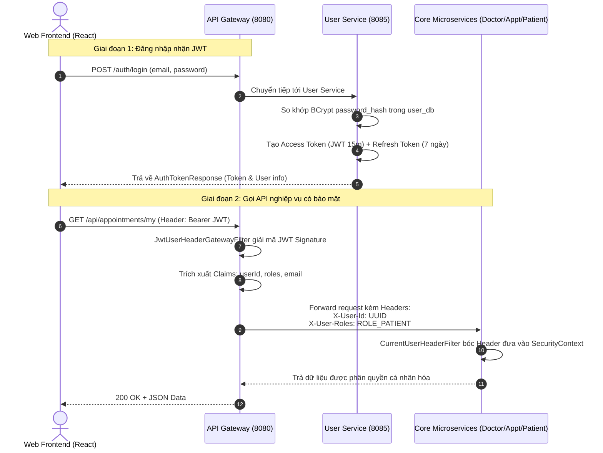
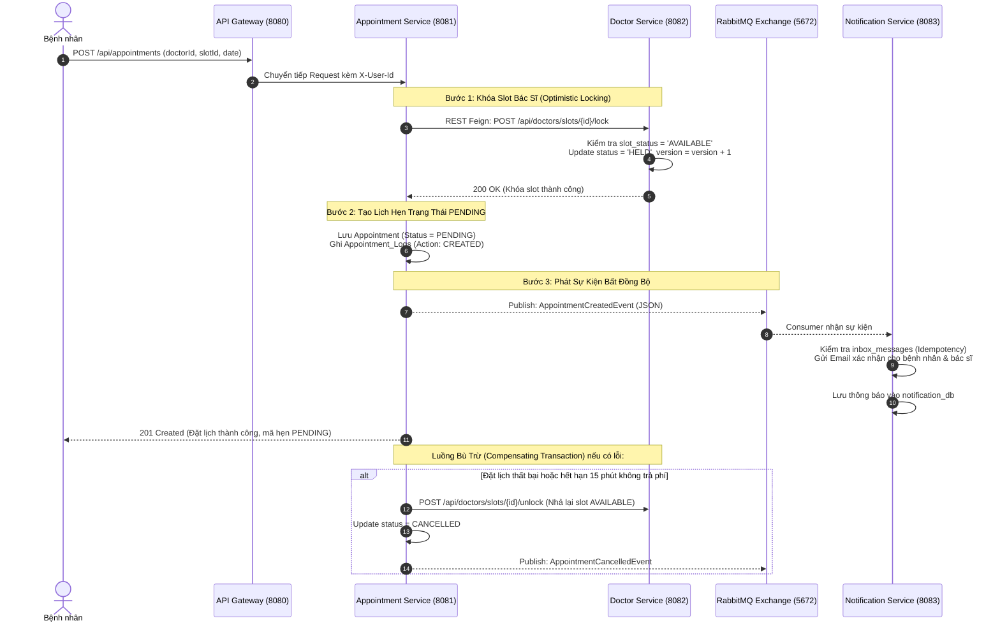

# BỘ TÀI LIỆU TOÀN DIỆN THUYẾT TRÌNH & BẢO VỆ ĐỒ ÁN MSS301
## ĐỀ TÀI: HỆ THỐNG ĐẶT LỊCH KHÁM BỆNH TRỰC TUYẾN MEDISYNC CLINIC
### HỌC KỲ: FALL 2026 | LỚP: MSS301 | NHÓM: GROUP 05
**Thành viên:** Nam, Long, Mười, Vũ, Quân  
**Thời lượng bảo vệ:** 25 phút thuyết trình & Demo + 10 phút Q&A hỏi đáp với Giảng viên

---

## MỤC LỤC TÀI LIỆU
1. **Tổng Quan Requirement Của Dự Án** (Problem Statement, 4 Actors, 14 Use Cases, NFRs)
2. **Architecture Design & Tổng Quan Services** (Kiến trúc 5 tầng, Service Discovery, Config, Gateway, 6 Services, RabbitMQ, Docker)
3. **Communication Diagrams (2 Use Cases Chính)** (JWT Auth Filter Context & SAGA Distributed Transaction)
4. **API Design (Thiết Kế RESTful APIs Chuẩn Microservices)**
5. **Database Design (Pattern Database-per-Service & Chi Tiết 6 CSDL)**
6. **Kịch Bản Demo Main Flow & Phân Bổ Thời Gian Thuyết Trình (25 Phút + 10 Phút Q&A)**
7. **Bộ 10 Câu Hỏi "Tủ" Giảng Viên Hay Hỏi Nhất & Câu Trả Lời Chuẩn Mực**

---

## PHẦN 1: TỔNG QUAN REQUIREMENT CỦA DỰ ÁN

### 1.1. Bài toán thực tế (Problem Statement)
- **Thực trạng y tế truyền thống:**
  - Bệnh nhân phải đến sớm bốc số thứ tự giấy, thời gian chờ khám từ 1 - 3 tiếng gây mệt mỏi và lây nhiễm chéo.
  - Xung đột lịch khám: Hai bệnh nhân cùng đến một thời điểm, bác sĩ bị quá tải trong khi các khung giờ khác lại trống.
  - Hồ sơ bệnh án giấy dễ thất lạc, rách nát, thông tin y tế phân tán giữa các chuyên khoa.
  - Thanh toán viện phí bằng tiền mặt mất thời gian xếp hàng đối soát.
- **Giải pháp MediSync Clinic:**
  - Ứng dụng nền tảng y tế số hóa dựa trên kiến trúc **Spring Boot Microservices**.
  - Cho phép đặt khám online 24/7 với khung giờ tiêu chuẩn **45 phút/ca khám**.
  - Áp dụng **Optimistic Locking** ngăn ngừa tuyệt đối đặt trùng lịch (Double Booking).
  - Tự động hóa điều phối sự kiện qua **RabbitMQ** và thanh toán không tiền mặt bằng **VNPay QR**.
  - Quản lý hồ sơ bệnh án điện tử (EMR) an toàn, tuân thủ tiêu chuẩn **HIPAA**.

### 1.2. Danh sách 4 Actors & Toàn bộ 14 Use Cases (UC)

Hệ thống có **14 Use Cases nghiệp vụ** được phân quyền theo mô hình **Role-Based Access Control (RBAC)**:

| STT | Mã UC | Tên Use Case | Actor thực hiện | Service đảm nhiệm |
|:---:|:---:|:---|:---:|:---|
| 1 | **UC01** | Xem thông tin phòng khám & danh bạ bác sĩ | Khách (Guest) | `doctor-service` |
| 2 | **UC02** | Đăng ký tài khoản & Kích hoạt hồ sơ tự động | Khách (Guest) | `user-service`, `patient-service` |
| 3 | **UC03** | Đăng nhập & Cấp phát JWT Access / Refresh Token | Tất cả User | `user-service`, `api-gateway` |
| 4 | **UC04** | Khôi phục mật khẩu qua Email OTP | Khách / User | `user-service`, `notification-service` |
| 5 | **UC05** | Tra cứu danh sách bác sĩ & Khung giờ trống | Bệnh nhân (Patient) | `doctor-service` |
| 6 | **UC06** | Đặt lịch khám & Khóa slot 45 phút (SAGA + Optimistic Lock)| Bệnh nhân (Patient) | `appointment-service`, `doctor-service` |
| 7 | **UC07** | Xem lịch khám cá nhân & Hủy lịch hẹn | Bệnh nhân (Patient) | `appointment-service`, `doctor-service` |
| 8 | **UC08** | Thanh toán viện phí trực tuyến qua mã QR | Bệnh nhân (Patient) | `payment-service` |
| 9 | **UC09** | Xem hồ sơ y tế & Tiền sử bệnh án cá nhân (EMR) | Bệnh nhân (Patient) | `patient-service` |
| 10 | **UC10** | Xem bàn làm việc ca trực & Duyệt ca khám (Confirm)| Bác sĩ (Doctor) | `doctor-service`, `appointment-service` |
| 11 | **UC11** | Thăm khám & Cập nhật chẩn đoán bệnh án điện tử | Bác sĩ (Doctor) | `patient-service` |
| 12 | **UC12** | Xác nhận hoàn tất ca khám bệnh (Complete) | Bác sĩ (Doctor) | `appointment-service` |
| 13 | **UC13** | Quản lý điều phối lịch hẹn & Báo cáo doanh thu toàn viện | Quản trị viên (Admin) | `appointment-service`, `payment-service` |
| 14 | **UC14** | Giám sát kiến trúc Microservices & Hàng đợi RabbitMQ | Quản trị viên (Admin) | `api-gateway`, `eureka-server` |

---

## PHẦN 2: ARCHITECTURE DESIGN & TỔNG QUAN SERVICES

### 2.1. Sơ đồ Kiến trúc 5 Tầng (5-Tier Microservices Architecture)

```
[ Tier 1: Client Layer ]
      │  Vite React Single Page Application (Responsive UI, Port 5173)
      ▼
[ Tier 2: Edge Routing & Security Layer ]
      │  Spring Cloud API Gateway (Port 8080)
      │  ├── JWT Validation Filter (Giải mã Claims, Header Transformation)
      │  ├── Correlation ID Filter (Gắn UUID truy vết xuyên suốt hệ thống)
      │  └── Circuit Breaker & CORS Policy
      ▼
[ Tier 3: Platform Services Layer ]
      ├── Netflix Eureka Server (Service Registry - Port 8761)
      └── Spring Cloud Config Server (Centralized Git Config - Port 8888)
      ▼
[ Tier 4: Core Business Microservices Layer ]
      ├── 1. User & Auth Service        (Port 8085)
      ├── 2. Doctor Service             (Port 8082)
      ├── 3. Patient Service            (Port 8084)
      ├── 4. Appointment Service (SAGA) (Port 8081)
      ├── 5. Payment Service            (Port 8086)
      └── 6. Notification Service       (Port 8083)
      ▼
[ Tier 5: Data & Event Streaming Layer ]
      ├── PostgreSQL 15 Alpine (6 Isolated DBs: Ports 55432 - 55437)
      └── RabbitMQ 3 Management (AMQP Message Broker: Port 5672, UI: 15672)
```

### 2.2. Bảng thông số chi tiết 6 Business Microservices

| Service | Port | Database riêng | Cổng DB | Trách nhiệm cốt lõi | Sự kiện RabbitMQ trao đổi |
|:---|:---:|:---|:---:|:---|:---|
| **User Service** | `8085` | `user_db` | `55436` | Quản lý tài khoản, mã hóa BCrypt, cấp phát JWT & Refresh Token | `user.registered`, `user.password.reset` |
| **Doctor Service** | `8082` | `doctor_db` | `55433` | Quản lý hồ sơ bác sĩ, phân bổ ca khám 45 phút, Optimistic Lock (`version`) | Nhận yêu cầu khóa slot / nhả slot |
| **Patient Service** | `8084` | `patient_db` | `55435` | Hồ sơ hành chính bệnh nhân, bệnh án điện tử EMR tuân thủ chuẩn HIPAA | `patient.profile.created` |
| **Appointment Service** | `8081` | `appointment_db` | `55432` | SAGA Orchestrator: Đặt lịch, hủy lịch, hoàn tất khám, Audit Log | `appointment.created`, `appointment.cancelled` |
| **Payment Service** | `8086` | `payment_db` | `55437` | Lập hóa đơn viện phí, tích hợp quét mã VNPay QR, xử lý IPN Webhook | `payment.completed`, `payment.failed` |
| **Notification Service** | `8083` | `notification_db` | `55434` | Lắng nghe event từ RabbitMQ, gửi Email/SMS, Idempotent Consumer | Lắng nghe tất cả các exchange sự kiện |

---

## PHẦN 3: COMMUNICATION DIAGRAMS (2 USE CASES CHÍNH)

### 3.1. Use Case Chính 1: Xác Thực JWT & Lan Truyền Định Danh (Auth & Context Propagation)



- **Điểm nhấn bảo vệ:** Các microservices phía sau không cần kết nối tới `user_db` để kiểm tra token. **API Gateway** đóng vai trò Gateway Offloading, giải mã JWT một lần duy nhất và lan truyền thông tin qua `X-User-Id` và `X-User-Roles`.

---

### 3.2. Use Case Chính 2: Đặt Lịch Khám Bệnh & Giao Dịch Phân Tán SAGA (Booking Flow)



- **Điểm nhấn bảo vệ:** 
  1. Sử dụng **SAGA Pattern (Orchestration-based)**: `appointment-service` giữ vai trò nhạc trưởng điều phối.
  2. Bảng `doctor_slots` có cột `version` (`@Version` của JPA Hibernate) hiện thực **Optimistic Locking**: Nếu 2 bệnh nhân bấm đặt cùng 1 mili-giây, giao dịch thứ hai văng `OptimisticLockException` và báo lỗi ngay, chống tuyệt đối Overbooking.

---

## PHẦN 4: API DESIGN (RESTFUL MICROSERVICES STANDARDS)

### 4.1. Chuẩn thiết kế API
- **Base URL qua API Gateway:** `http://localhost:8080`
- **Chuẩn định dạng:** `application/json; charset=UTF-8`
- **Mã phản hồi HTTP chuẩn:**
  - `200 OK`: Truy vấn hoặc cập nhật thành công.
  - `201 Created`: Tạo mới tài nguyên thành công (Đăng ký, Đặt lịch).
  - `400 Bad Request`: Dữ liệu đầu vào không hợp lệ (Validation DTO fail).
  - `401 Unauthorized`: Chưa truyền JWT hoặc JWT hết hạn.
  - `403 Forbidden`: Không đủ quyền (Ví dụ: Bệnh nhân cố duyệt ca khám của Bác sĩ).
  - `404 Not Found`: Không tìm thấy tài nguyên.
  - `409 Conflict`: Xung đột dữ liệu / Khóa lạc quan (Slot đã có người đặt).

### 4.2. Bảng tổng hợp Endpoint chính theo từng Service

| Service | HTTP Method | Endpoint qua Gateway | Vai trò được phép | Mô tả nghiệp vụ |
|:---|:---:|:---|:---:|:---|
| **User** | `POST` | `/auth/login` | Public | Đăng nhập nhận Access & Refresh Token |
| **User** | `POST` | `/api/users/register` | Public | Đăng ký tài khoản bệnh nhân/bác sĩ |
| **User** | `POST` | `/auth/forgot-password`| Public | Yêu cầu OTP khôi phục mật khẩu |
| **User** | `POST` | `/auth/reset-password` | Public | Xác thực OTP & đổi mật khẩu mới |
| **Doctor** | `GET` | `/api/doctors` | Public / All | Lấy danh sách bác sĩ chuyên khoa |
| **Doctor** | `GET` | `/api/doctors/{id}/slots`| Public / All | Xem các khung giờ khám còn trống |
| **Patient** | `GET` | `/api/patients/me` | PATIENT | Lấy hồ sơ y tế bệnh nhân đăng nhập |
| **Patient** | `GET` | `/api/patients/{id}/records`| DOCTOR, ADMIN | Xem tiền sử bệnh án điện tử EMR |
| **Appointment**| `POST`| `/api/appointments` | PATIENT | Tạo lịch hẹn & khóa slot khám |
| **Appointment**| `GET` | `/api/appointments/my` | PATIENT, DOCTOR | Lấy danh sách lịch hẹn cá nhân hóa |
| **Appointment**| `PUT` | `/api/appointments/{id}/confirm`| DOCTOR | Bác sĩ duyệt tiếp nhận ca khám |
| **Appointment**| `PUT` | `/api/appointments/{id}/cancel` | PATIENT, ADMIN | Hủy lịch hẹn & kích hoạt giao dịch bù |
| **Payment** | `POST` | `/api/payments/pay/{id}` | PATIENT | Thanh toán viện phí VNPay QR |
| **Notification**| `GET`| `/api/notifications/my`| PATIENT, DOCTOR | Đọc các thông báo xác nhận lịch |

---

## PHẦN 5: DATABASE DESIGN (DATABASE-PER-SERVICE)

Hệ thống tuân thủ nghiêm ngặt nguyên lý **Database-per-Service**: Mỗi microservice sở hữu CSDL PostgreSQL riêng biệt, bảo đảm độc lập schema, tăng tính chịu lỗi (Fault Tolerance) và khả năng scale theo tải.

```
┌─────────────────┐   ┌─────────────────┐   ┌─────────────────┐
│     user_db     │   │   patient_db    │   │    doctor_db    │
│   (Port 55436)  │   │  (Port 55435)   │   │  (Port 55433)   │
│ ─────────────── │   │ ─────────────── │   │ ─────────────── │
│ • users         │   │ • patients      │   │ • doctors       │
│ • roles         │   │ • medical_      │   │ • doctor_slots  │
│ • user_roles    │   │   records       │   │   (version PK)  │
│ • refresh_tokens│   │   (HIPAA Safe)  │   │                 │
└─────────────────┘   └─────────────────┘   └─────────────────┘
         ▲                     ▲                     ▲
         │                     │                     │
┌─────────────────┐   ┌─────────────────┐   ┌─────────────────┐
│ appointment_db  │   │ notification_db │   │   payment_db    │
│   (Port 55432)  │   │  (Port 55434)   │   │  (Port 55437)   │
│ ─────────────── │   │ ─────────────── │   │ ─────────────── │
│ • appointments  │   │ • notifications │   │ • payments      │
│ • appointment_  │   │ • inbox_messages│   │ • payment_      │
│   logs (Audit)  │   │   (Idempotent)  │   │   attempts (IPN)│
└─────────────────┘   └─────────────────┘   └─────────────────┘
```

- **`user_db` (Port 55436):** Bảng `users`, `roles`, `user_roles`, `refresh_tokens`. Quản lý tài khoản, mã hóa mật khẩu an toàn bằng BCrypt và lưu token phục vụ thu hồi token (Token Revocation).
- **`patient_db` (Port 55435):** Bảng `patients`, `medical_records`. Lưu trữ tiền sử bệnh án, chẩn đoán, toa thuốc theo tiêu chuẩn bảo mật y tế HIPAA, cách ly hoàn toàn khỏi bảng tài khoản.
- **`doctor_db` (Port 55433):** Bảng `doctors`, `doctor_slots`. Cột `version` INTEGER đóng vai trò khóa lạc quan (`@Version`) ngăn chặn đặt trùng ca khám.
- **`appointment_db` (Port 55432):** Bảng `appointments`, `appointment_logs`. Bảng log lưu vết kiểm toán (Audit Trail) ghi nhận toàn bộ bước chuyển trạng thái SAGA và các thao tác bù trừ.
- **`notification_db` (Port 55434):** Bảng `notifications`, `inbox_messages`. Hiện thực mẫu **Idempotent Consumer Pattern** chống gửi trùng lặp email khi RabbitMQ retry event.
- **`payment_db` (Port 55437):** Bảng `payments`, `payment_attempts`. Lưu vết lịch sử giao dịch và dữ liệu Webhook IPN từ cổng thanh toán QR.

---

## PHẦN 6: KỊCH BẢN THUYẾT TRÌNH & DEMO CHI TIẾT (25 PHÚT + 10 PHÚT Q&A)

### Bảng phân công thời gian trình bày chuẩn chỉ:

```
[ 00:00 - 05:00 ] (5 phút) : Nguyễn Mạnh Quân (Leader) - Mở đầu & Tổng quan
[ 05:00 - 09:00 ] (4 phút) : Nam                      - Auth, Security, Gateway & User DB
[ 09:00 - 13:00 ] (4 phút) : Long                     - Doctor Service & Optimistic Locking
[ 13:00 - 17:00 ] (4 phút) : Mười                     - Patient Service & Bệnh án HIPAA
[ 17:00 - 21:00 ] (4 phút) : Vũ                       - SAGA, Payment QR & RabbitMQ Event
[ 21:00 - 25:00 ] (4 phút) : Nguyễn Mạnh Quân (Leader) - Live Demo End-to-End & Kết luận
[ 25:00 - 35:00 ] (10 phút): Cả Nhóm 05                - Q&A Hỏi & Đáp với Giảng viên
```

---

### KỊCH BẢN NÓI CHI TIẾT CHO TỪNG THÀNH VIÊN:

#### 1. Nguyễn Mạnh Quân (Leader) | Phút 00:00 - 05:00 (5 phút)
- **Lời thoại mở đầu:**
  > *"Kính chào thầy cô và các bạn! Em là Nguyễn Mạnh Quân, đại diện cho Nhóm 05 môn MSS301 trình bày đề tài: 'Hệ thống Đặt lịch Khám bệnh Trực tuyến MediSync Clinic dựa trên Kiến trúc Microservices'."*
- **Nội dung trình bày:**
  1. Nêu bài toán thực tế: Quá tải bệnh viện, xung đột lịch khám, hồ sơ giấy phân tán.
  2. Giới thiệu tổng quan Requirement: 4 Actor (Khách, Bệnh nhân, Bác sĩ, Admin) và 14 Use Cases nghiệp vụ.
  3. Trình chiếu sơ đồ Kiến trúc 5 Tầng: Giải thích API Gateway (8080), Eureka (8761), Config Server (8888), 6 Microservices độc lập, RabbitMQ và Docker Compose.
- **Chuyển lời thoại:**
  > *"Tiếp theo, em xin mời bạn Nam trình bày về phân hệ Xác thực, Bảo mật và Quản lý Người dùng."*

---

#### 2. Nam | Phút 05:00 - 09:00 (4 phút)
- **Nội dung trình bày:**
  1. Trình bày **User Service (Port 8085)** và **API Gateway (Port 8080)**.
  2. Giải thích Communication Diagram 1: Luồng Đăng nhập cấp JWT (Access Token 15 phút, Refresh Token 7 ngày) và cơ chế giải mã Header transformation tại Gateway (`X-User-Id`, `X-User-Roles`).
  3. Trình chiếu Database `user_db` (Port 55436): Cấu trúc 4 bảng (`users`, `roles`, `user_roles`, `refresh_tokens`) và cơ chế băm mật khẩu an toàn bằng **BCrypt**.
- **Chuyển lời thoại:**
  > *"Sau đây, bạn Long sẽ trình bày về Doctor Service và cơ chế Khóa lạc quan chống đặt trùng lịch."*

---

#### 3. Long | Phút 09:00 - 13:00 (4 phút)
- **Nội dung trình bày:**
  1. Trình bày **Doctor Service (Port 8082)**: Quản lý danh mục bác sĩ chuyên khoa và phân bổ ca khám 45 phút.
  2. Trình bày Database `doctor_db` (Port 55433): Cấu trúc bảng `doctors` và `doctor_slots`.
  3. **Điểm nhấn kỹ thuật:** Cơ chế **Optimistic Locking**: Giải thích trường `version` trong bảng `doctor_slots`. Khi 2 bệnh nhân cùng lúc bấm đặt 1 ca khám, phiên bản version sẽ kiểm soát để chỉ 1 người thành công, loại bỏ triệt để hiện tượng Overbooking.
- **Chuyển lời thoại:**
  > *"Tiếp theo, xin mời bạn Mười trình bày về Patient Service và tiêu chuẩn bảo vệ hồ sơ bệnh án."*

---

#### 4. Mười | Phút 13:00 - 17:00 (4 phút)
- **Nội dung trình bày:**
  1. Trình bày **Patient Service (Port 8084)**: Quản lý thông tin định danh y tế và hồ sơ bệnh án điện tử (EMR).
  2. Trình chiếu Database `patient_db` (Port 55435): Bảng `patients` và `medical_records`.
  3. **Điểm nhấn kỹ thuật:** Tiêu chuẩn bảo mật **HIPAA (Health Insurance Portability and Accountability Act)**: Tách rời bảng bệnh án khỏi bảng tài khoản xác thực, mã hóa chẩn đoán và chỉ cấp quyền truy xuất hồ sơ y tế cho Bác sĩ điều trị và chính Bệnh nhân đó.
- **Chuyển lời thoại:**
  > *"Sau đây, bạn Vũ sẽ trình bày về luồng SAGA Đặt lịch, Cổng thanh toán QR và Xử lý sự kiện RabbitMQ."*

---

#### 5. Vũ | Phút 17:00 - 21:00 (4 phút)
- **Nội dung trình bày:**
  1. Trình bày **Appointment Service (Port 8081)**, **Payment Service (Port 8086)** và **Notification Service (Port 8083)**.
  2. Giải thích Communication Diagram 2: Luồng **SAGA Pattern (Orchestration)**: Đặt lịch ➔ Khóa ca khám ➔ Bắn Event RabbitMQ ➔ Gửi Email thông báo. Nếu giao dịch lỗi sẽ kích hoạt **Compensating Transaction** để nhả slot.
  3. Giới thiệu Cổng thanh toán **VNPay QR** và Cơ chế **Idempotent Consumer** với bảng `inbox_messages` trong `notification_db` chống gửi trùng lặp email.
- **Chuyển lời thoại:**
  > *"Em xin nhường lại phần trình bày cho Leader Nguyễn Mạnh Quân tiến hành Live Demo toàn bộ hệ thống."*

---

#### 6. Nguyễn Mạnh Quân (Leader) | Phút 21:00 - 25:00 (4 phút) - LIVE DEMO
- **Thực hiện Demo trực tiếp trên giao diện Web (`http://localhost:5173`):**
  1. **Demo Màn 1 (Khách):** Cho thầy cô thấy Trang chủ Tổng quan Phòng khám khi chưa đăng nhập. Thử bấm tính năng **Quên mật khẩu** (Gửi mã OTP mô phỏng RabbitMQ `888666` ➔ Đổi mật khẩu thành công).
  2. **Demo Màn 2 (Bệnh nhân):** Đăng nhập nhanh tài khoản Bệnh nhân Nguyễn Mạnh Quân ➔ Chọn Bác sĩ Nguyễn Văn An ➔ Đặt lịch khám khung giờ 09:00 - 09:45 ➔ Lịch hẹn tạo thành công với trạng thái `PENDING`.
  3. **Demo Màn 3 (Bác sĩ):** Đổi góc nhìn sang BS. CKI Nguyễn Văn An ➔ Mở tab Ca khám ➔ Thấy ca khám của Quân ➔ Bấm **Duyệt ca khám (Confirm)** ➔ Mở modal Bệnh án điện tử cập nhật chẩn đoán.
  4. **Demo Màn 4 (Thanh toán & Thông báo):** Bệnh nhân quét mã **VNPay QR** thanh toán viện phí 250.000đ ➔ Trạng thái chuyển thành `PAID` ➔ Mở tab Hộp thư thông báo chứng minh Notification Service đã bắt event gửi Email từ RabbitMQ.
- **Lời kết:**
  > *"Phần trình bày và Live Demo của Nhóm 05 đến đây là kết thúc. Nhóm chúng em rất mong nhận được những nhận xét và câu hỏi đánh giá từ thầy cô!"*

---

## PHẦN 7: BỘ 10 CÂU HỎI "TỦ" GIẢNG VIÊN HAY HỎI VÀ CÂU TRẢ LỜI CHUẨN MỰC

#### Câu 1: Tại sao hệ thống lại tách thành 6 database riêng biệt thay vì dùng 1 database chung?
- **Trả lời:** Đây là mẫu thiết kế **Database-per-Service** bắt buộc trong kiến trúc Microservices chuẩn:
  1. **Độc lập triển khai (Decoupling):** Mỗi service tự do thay đổi schema, migration mà không làm hỏng service khác.
  2. **Chịu lỗi (Fault Tolerance):** Nếu `payment_db` hoặc `notification_db` gặp sự cố, dịch vụ đặt lịch khám và tra cứu bác sĩ vẫn hoạt động bình thường.
  3. **Scale độc lập:** Service có tần suất truy vấn cao như `doctor_db` có thể scale database riêng mà không tốn tài nguyên cho các service ít đọc/ghi.
  4. **Bảo mật HIPAA:** CSDL hồ sơ bệnh nhân (`patient_db`) được cô lập ở mức mạng riêng, ngăn chặn nguy cơ rò rỉ bệnh án nếu service xác thực bị tấn công.

#### Câu 2: Khi 2 bệnh nhân cùng lúc bấm đặt 1 slot ca khám, hệ thống giải quyết như thế nào?
- **Trả lời:** Hệ thống áp dụng cơ chế **Optimistic Locking** thông qua annotation `@Version` của JPA trên trường `version` trong bảng `doctor_slots` (`doctor_db`):
  - Khi transaction đầu tiên commit thành công, giá trị `version` tăng từ $N \rightarrow N+1$.
  - Transaction thứ hai khi commit sẽ phát hiện `version` trên DB đã khác với bản sao lúc đọc, Hibernate sẽ lập tức ném ra ngoại lệ `OptimisticLockException`.
  - Service bắt ngoại lệ này và trả về mã lỗi HTTP `409 Conflict` kèm thông báo: *"Ca khám này vừa được đặt bởi người khác, vui lòng chọn ca khác"*. Nhờ đó không cần dùng Pessimistic Lock gây nghẽn database.

#### Câu 3: Làm thế nào để đảm bảo tính nhất quán dữ liệu (Data Consistency) giữa các microservice khi đặt lịch khám?
- **Trả lời:** Do không thể dùng Transaction ACID phân tán (như 2PC - Two Phase Commit vì hiệu năng kém), nhóm em áp dụng **SAGA Pattern** với điều phối tập trung (**Orchestration**):
  - `appointment-service` đóng vai trò Orchestrator. Nó lần lượt gọi: (1) Khóa slot bác sĩ ➔ (2) Lưu appointment trạng thái PENDING ➔ (3) Phát event sang RabbitMQ.
  - Nếu bất kỳ bước nào thất bại (ví dụ: bệnh nhân hủy hẹn hoặc không thanh toán viện phí trong thời gian quy định), Orchestrator sẽ kích hoạt chuỗi **Giao dịch bù trừ (Compensating Transactions)**: Gọi `doctor-service` mở khóa lại slot ca khám thành `AVAILABLE` và cập nhật lịch hẹn thành `CANCELLED`.

#### Câu 4: API Gateway đóng vai trò gì trong hệ sinh thái này?
- **Trả lời:** API Gateway (xây dựng trên **Spring Cloud Gateway**) là điểm truy cập duy nhất (Single Point of Entry) với 4 nhiệm vụ cốt lõi:
  1. **Định tuyến (Dynamic Routing):** Phối hợp cùng Netflix Eureka để cân bằng tải và điều hướng URL tới đúng service instance.
  2. **Bảo mật tập trung (Gateway Offloading):** Kiểm tra chữ ký số JWT, từ chối request không hợp lệ ngay tại cửa ngõ trước khi request chạm vào microservices bên trong.
  3. **Lan truyền ngữ cảnh (Context Propagation):** Trích xuất `userId` và `roles` từ JWT rồi gắn vào request headers (`X-User-Id`, `X-User-Roles`) chuyển tiếp cho các service con.
  4. **Quan sát (Observability):** Gắn mã `X-Correlation-Id` (UUID) cho mỗi request để truy vết toàn bộ log xuyên suốt qua các service.

#### Câu 5: Nếu RabbitMQ gửi lại một Event nhiều lần (At-least-once delivery), làm sao tránh gửi email trùng lặp cho bệnh nhân?
- **Trả lời:** Phân hệ `notification-service` hiện thực mẫu **Idempotent Consumer Pattern**:
  - Trong `notification_db`, nhóm thiết kế bảng `inbox_messages` với khóa chính là `message_id` (UUID của sự kiện).
  - Khi nhận event từ RabbitMQ, Consumer sẽ kiểm tra: Nếu `message_id` đã tồn tại trong `inbox_messages` thì bỏ qua (Acknowledge) mà không gửi lại email.
  - Nếu chưa có, Consumer tiến hành gửi email và chèn `message_id` vào bảng trong cùng một transaction. Nhờ đó bảo đảm tính ngữ nghĩa **Exactly-once processing**.

#### Câu 6: Eureka Server và Config Server hoạt động như thế nào?
- **Trả lời:**
  - **Eureka Server (Port 8761):** Đóng vai trò Service Registry. Mỗi khi một microservice khởi động, nó tự động đăng ký tên và địa chỉ IP:Port với Eureka và gửi Heartbeat định kỳ mỗi 30 giây. API Gateway dựa vào Eureka để phân giải tên service (ví dụ: `lb://appointment-service`).
  - **Config Server (Port 8888):** Quản lý tập trung toàn bộ file cấu hình `application.yml` trong một git repository riêng (`clinic-config-repo`). Khi cần thay đổi cấu hình (như connection pool, timeout), ta chỉ cần commit vào repo config mà không phải build lại code của các service.

#### Câu 7: Hồ sơ bệnh án điện tử (EMR) được bảo vệ theo chuẩn HIPAA như thế nào?
- **Trả lời:**
  1. **Phân tách vật lý CSDL:** Dữ liệu bệnh án nằm trong `patient_db`, tách biệt hoàn toàn với CSDL người dùng `user_db`.
  2. **Kiểm soát truy cập dựa trên vai trò (RBAC):** Chỉ tài khoản có vai trò `ROLE_DOCTOR` được chỉ định hoặc chính bệnh nhân sở hữu hồ sơ mới được quyền đọc bệnh án.
  3. **Audit Logging:** Mọi hành vi tạo mới hoặc cập nhật bệnh án đều ghi lại `doctorId`, `patientId` và dấu thời gian `timestamp` phục vụ kiểm toán y khoa.

#### Câu 8: Cơ chế thanh toán VNPay QR được xử lý như thế nào?
- **Trả lời:**
  1. Bệnh nhân chọn hóa đơn viện phí ➔ `payment-service` sinh mã giao dịch duy nhất `transactionRef` và mã QR chứa thông tin thanh toán.
  2. Khi quét mã QR và chuyển tiền thành công, cổng thanh toán sẽ gọi về một Webhook ngầm (**IPN - Instant Payment Notification**) tại endpoint `/api/payments/vnpay-ipn`.
  3. `payment-service` kiểm tra chữ ký số (Checksum HMAC-SHA512), cập nhật trạng thái hóa đơn thành `PAID` và phát sự kiện `PaymentCompletedEvent` qua RabbitMQ để `appointment-service` xác nhận hoàn tất thủ tục.

#### Câu 9: Tính năng "Quên mật khẩu" hoạt động theo luồng nào?
- **Trả lời:**
  1. Khách nhập email ➔ `user-service` kiểm tra tài khoản, sinh mã OTP 6 chữ số có thời hạn 10 phút.
  2. `user-service` phát sự kiện `UserPasswordResetRequestedEvent` qua **RabbitMQ**.
  3. `notification-service` nhận sự kiện và gửi email OTP thật đến hòm thư người dùng (bảo đảm xử lý bất đồng bộ, không làm nghẽn User Service).
  4. Người dùng nhập OTP + Mật khẩu mới ➔ `user-service` xác thực OTP, mã hóa mật khẩu mới bằng BCrypt và cập nhật vào `user_db`.

#### Câu 10: Nếu có 1 Microservice bị sập (ví dụ Notification Service), hệ thống có chết theo không?
- **Trả lời:** **Hoàn toàn KHÔNG!**
  - Nhờ sử dụng hàng đợi thông điệp **RabbitMQ (Asynchronous Message Broker)**, `appointment-service` chỉ việc đẩy event vào Exchange rồi phản hồi thành công ngay lập tức cho người dùng mà không cần chờ đợi.
  - Thông điệp được lưu an toàn trong Message Queue (Durable Queue). Khi `notification-service` được khởi động lại, nó sẽ tự động tiêu thụ các message tồn đọng và tiếp tục gửi email bình thường, thể hiện đặc tính **Cao độ Chịu lỗi (Resilience & Eventual Consistency)** của kiến trúc Microservices.
