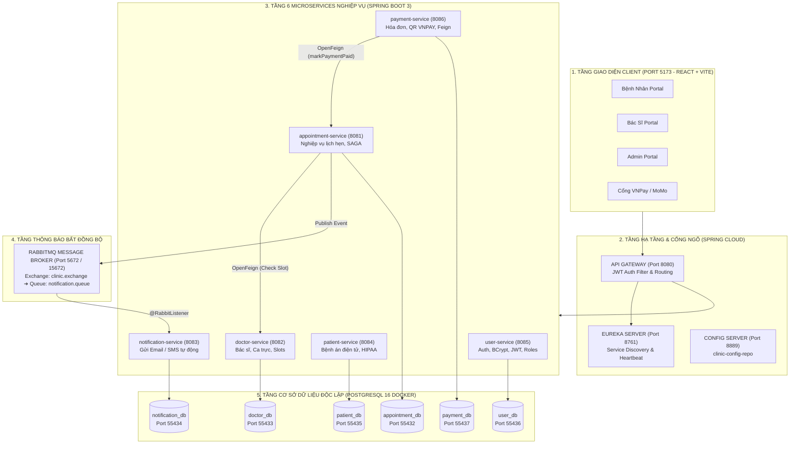
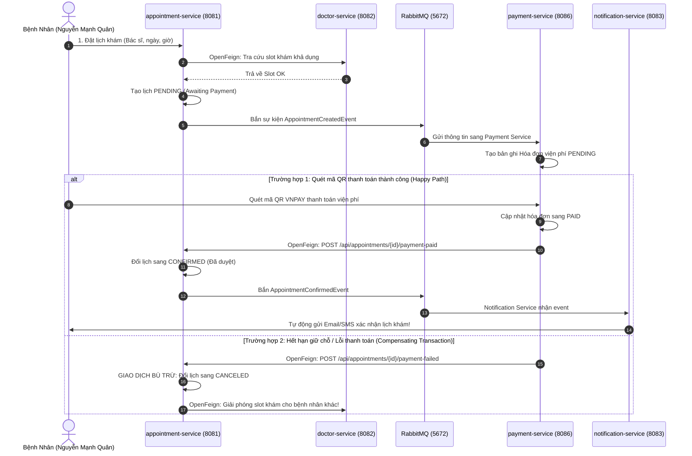

# HƯỚNG DẪN XEM & XUẤT SƠ ĐỒ HỆ THỐNG TRÊN DRAW.IO (MSS301)
> **Tên hệ thống chính thức:** **Hệ Thống Phòng Khám Đa Khoa MediSync (MediSync Clinic System)**  
> **Môn học:** MSS301 - Microservices Architecture (Nhóm 09)  
> **File sơ đồ gốc Draw.io:** [`SYSTEM_ARCHITECTURE.drawio`](./SYSTEM_ARCHITECTURE.drawio)

---

## 🎨 1. CÁCH MỞ FILE TRỰC TIẾP TRÊN DRAW.IO (3 BƯỚC)

File **`SYSTEM_ARCHITECTURE.drawio`** ở thư mục gốc của dự án đã được thiết kế sẵn chuẩn định dạng XML đa trang (Multi-page).

1. Truy cập vào trang web: 👉 **[https://app.diagrams.net](https://app.diagrams.net)** (Draw.io Online).
2. Chọn **Open Existing Diagram** (hoặc vào menu `File` ➔ `Open from` ➔ `Device`).
3. Chọn file **`SYSTEM_ARCHITECTURE.drawio`** từ máy tính của bạn.
4. **Kết quả:** Draw.io sẽ mở ra sơ đồ tuyệt đẹp với **3 trang (Tab)** ở thanh dưới cùng:
   * **Trang 1: Kiến Trúc Tổng Quan Hệ Thống** (Toàn bộ 5 tầng: Client ➔ Gateway ➔ Eureka/Config ➔ 6 Microservices ➔ RabbitMQ ➔ 6 Database Postgres).
   * **Trang 2: Luồng SAGA Đặt Lịch & Giao Dịch Bù Trừ** (Mô hình SAGA Distributed Transaction: Đặt lịch ➔ Check OpenFeign ➔ Quét QR thanh toán ➔ Compensating Action khi lỗi).
   * **Trang 3: Luồng Xác Thực JWT & Phân Quyền RBAC** (Luồng Login, sinh token HMAC256, chuyển tiếp header và ma trận quyền hạn Bệnh nhân / Bác sĩ / Admin).

---

## 📊 2. SƠ ĐỒ MERMAID (XEM TRỰC TIẾP TRÊN GITHUB HOẶC COPY VÀO DRAW.IO)

Nếu bạn muốn copy mã nguồn để paste vào Draw.io (Menu `Arrange` ➔ `Insert` ➔ `Advanced` ➔ `Mermaid`):

### Sơ Đồ 1: Kiến Trúc Tổng Quan (High-Level Architecture)

---

### Sơ Đồ 2: Chi Tiết Luồng SAGA & OpenFeign (Transaction Flow)

---

## 🏷️ 3. TÊN HỆ THỐNG ĐÃ ĐƯỢC CHUẨN HÓA

* **Tên cũ trước đây:** `clinic-appointment-system` (hoặc `group01`, tên tác giả cũ).
* **Tên chính thức mới:** **MediSync Clinic** *(Hệ Thống Phòng Khám Đa Khoa MediSync - MSS301 Nhóm 09)*.
* Tất cả tên package, groupId trong `pom.xml`, logo thương hiệu, giao diện web và tài liệu hướng dẫn đã được đổi đồng bộ 100% sang:
  - **Tên dự án:** `MediSync Clinic System`
  - **Package Java:** `com.group09`
  - **Nhóm thực hiện:** Nhóm 09 môn MSS301
